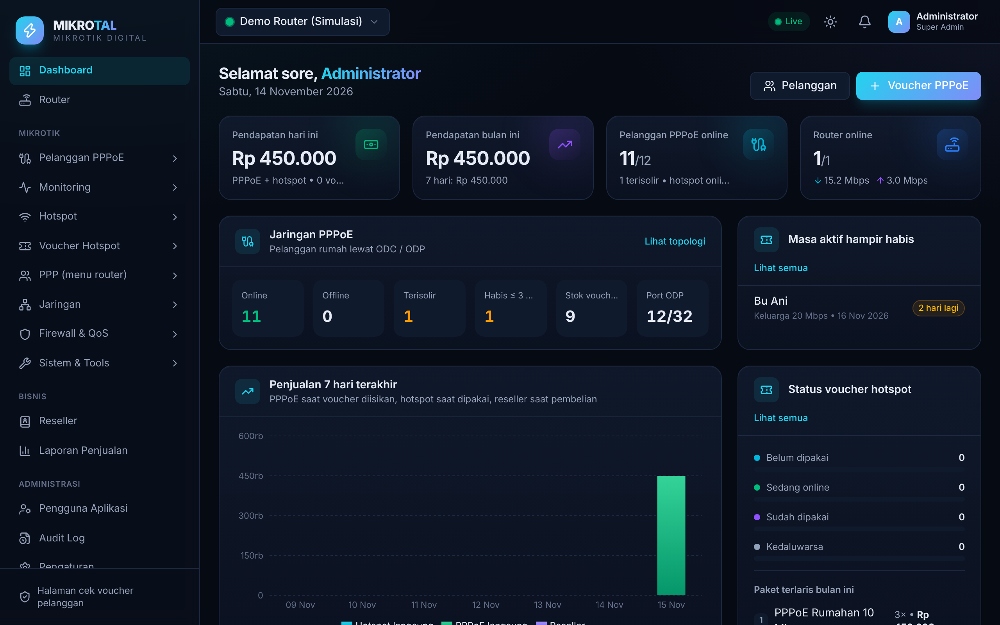
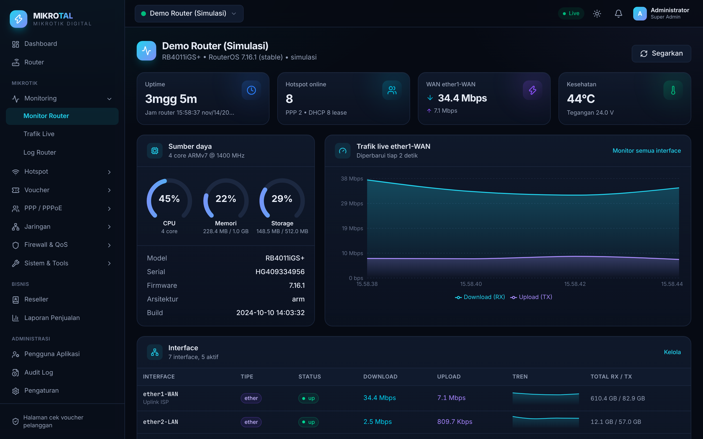
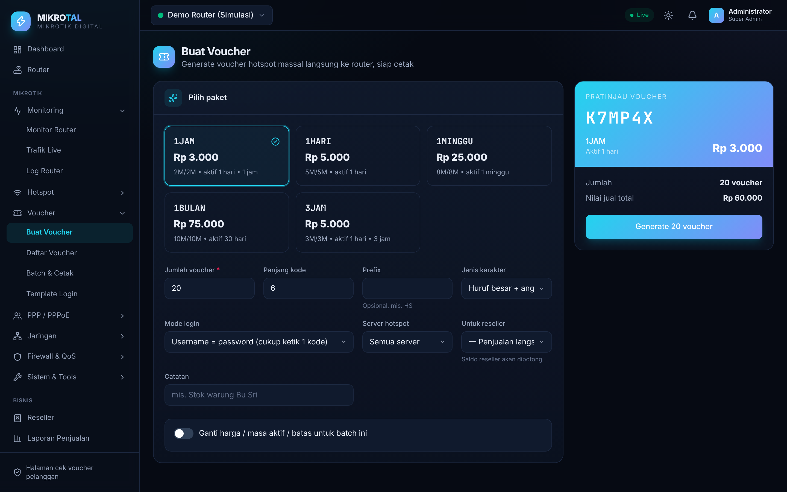
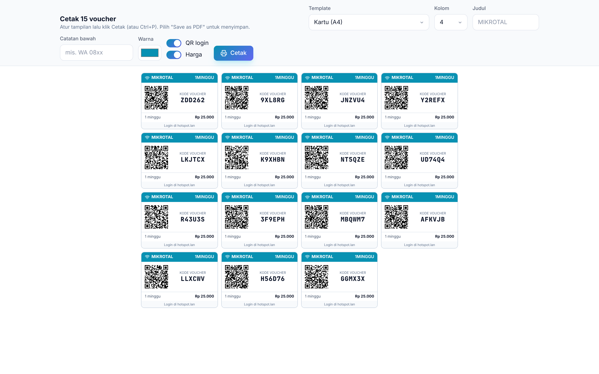

# MIKROTAL — Mikrotik Digital

Dashboard web untuk **monitoring, konfigurasi MikroTik, manajemen hotspot, dan penjualan voucher**. Satu aplikasi untuk banyak router, realtime, dan bisa dipakai dari HP. Winbox atau Mikhmon tidak diperlukan untuk pekerjaan sehari-hari.



## Fitur utama

### Monitoring realtime
- Dashboard multi-router: status online/offline, CPU, RAM, storage, uptime, suhu, dan tegangan.
- **Trafik live tiap 2 detik** lewat WebSocket untuk WAN dan semua interface, dengan grafik dan sparkline.
- Riwayat metrik (1 jam s/d 30 hari): CPU/RAM, trafik WAN, jumlah pengguna hotspot/PPP.
- Log router dengan filter topik, pencarian, dan auto-refresh.
- **Alert otomatis** untuk router offline/online, CPU/RAM/suhu tinggi, dan interface WAN down, dikirim di aplikasi dan ke **Telegram**. Histeresis mencegah notifikasi berulang-ulang.

### Konfigurasi MikroTik tanpa Winbox (40+ menu)
- **Jaringan**: Interface, Bridge, Bridge Port, VLAN, IP Address, Routing, IP Pool, DHCP Server/Network/Lease, DNS Static, ARP, Neighbor.
- **Firewall & QoS**: Filter, NAT, Mangle, Address List, Simple Queue, Queue Type.
- **PPP/PPPoE**: Secret, Profile, sesi aktif (putus koneksi), PPPoE Server.
- **Sistem**: identity, DNS, zona waktu & NTP, backup (.backup + .rsc), reboot, Scheduler, Script, User router, IP Service, File.
- **Tools**: ping dari router dan **terminal RouterOS API** dengan riwayat perintah.
- Semua tabel mendukung tambah/ubah/hapus, aktif/nonaktif, pencarian, dan aksi massal.

### Hotspot
- Sesi aktif live: putus pengguna, lihat sisa masa aktif voucher, pemakaian data.
- **Profil & Harga**: rate limit, shared users, timeout, plus harga jual, harga reseller, masa aktif, batas waktu, batas kuota, dan warna label.
- Pengguna hotspot, Host, IP Binding (bypass/blokir), Walled Garden, Server & Profil Server, Cookie.
- **Generator halaman login captive portal** (login.html) yang modern: daftar harga, tombol WhatsApp, mode voucher 1 kolom, dan kompatibel CHAP.

### Voucher & bisnis
- **Generate massal** (sampai 1000 per batch): prefix, panjang kode, jenis karakter tanpa huruf membingungkan (0/O, 1/I), username = password atau terpisah.
- **Cetak** dengan 3 template: kartu A4 dengan **QR login otomatis**, ringkas hemat kertas, dan struk **thermal 58mm**. Bisa disimpan sebagai PDF.
- **Sinkronisasi otomatis** dengan router. MIKROTAL mendeteksi kapan voucher pertama kali dipakai, menghitung masa aktif sejak login pertama, lalu menghapus atau menonaktifkan voucher yang kedaluwarsa (waktu/kuota/masa aktif habis).
- Impor pengguna hotspot lama (mis. dari Mikhmon) agar ikut dipantau.
- **Reseller dengan sistem saldo**: top up, potong saldo otomatis saat generate, refund voucher yang belum terpakai, riwayat transaksi, dan akun login khusus reseller.
- **Laporan penjualan**: harian, per profil, per reseller, per router, stok voucher, dan ekspor CSV.
- Halaman publik **/cek** untuk pelanggan memeriksa status dan sisa masa aktif voucher.

### RT/RW Net: pelanggan PPPoE lewat ODC / ODP
- **Pelanggan**: data pelanggan terhubung ke akun PPPoE (PPP secret) di router, paket, masa aktif, dan port ODP. Status online, IP, dan MAC router klien diperbarui otomatis.
- **Voucher isi ulang**: voucher adalah kode untuk memperpanjang masa aktif akun pelanggan yang tetap. Pelanggan tidak perlu mengubah setelan router di rumahnya. Sisa masa aktif tidak hangus.
- **Isolir otomatis**: saat masa aktif habis, akun dipindah ke profil isolir (bukan diputus). Begitu voucher diisikan, profil paket dikembalikan dan sesi disambung ulang.
- **Halaman pelanggan tanpa login**: `/isi` untuk cek masa aktif dan isi voucher, `/isolir` sebagai tujuan pengalihan saat terisolir.
- **Topologi ODC → ODP → pelanggan**: status tiap port (online, offline, terisolir, kosong) dan notifikasi bila semua pelanggan di satu ODP mati bersamaan.
- **Lokasi & peta jalur**: titik koordinat server, ODC, ODP, dan rumah pelanggan (ketik, tempel tautan Google Maps, lokasi HP di lapangan, atau klik di peta OpenStreetMap).
- **Troubleshoot jalur**: scan status PPPoE semua pelanggan untuk menunjuk segmen kabel yang diduga putus (feeder, distribusi, atau drop), lengkap dengan langkah pengecekan, pelanggan terdampak, log router, dan notifikasi otomatis.
- **Paket & harga**, perpanjangan manual (tunai/transfer), impor akun PPPoE yang sudah ada, voucher untuk reseller, dan laporan penjualan PPPoE.

### Keamanan & administrasi
- Multi-pengguna dengan 4 peran: **Super Admin, Admin, Operator, Reseller**.
- Password router disimpan terenkripsi **AES-256-GCM**, dan password pengguna di-hash dengan **scrypt**.
- **Audit log** untuk semua tindakan (siapa, apa, kapan, dari IP mana).
- Rate limit percobaan login. Perintah berbahaya di terminal hanya untuk Super Admin.
- Tema gelap/terang, responsif untuk HP.

| Monitor router | Buat voucher | Cetak voucher |
|---|---|---|
|  |  |  |

## Arsitektur

```
┌──────────────┐  HTTP + WebSocket  ┌─────────────────────────┐  RouterOS API  ┌───────────┐
│  Browser/HP  │ ◄────────────────► │  Server MIKROTAL (Node)  │ ◄────────────► │ MikroTik  │
│ React + Vite │                    │  Fastify + SQLite        │  8728 / 8729   │ (banyak)  │
└──────────────┘                    └─────────────────────────┘                └───────────┘
```

- **server/**: Node.js 22 + TypeScript + Fastify. Klien RouterOS API ditulis sendiri tanpa library (mendukung TLS, login lama/baru, banyak perintah paralel). Database SQLite bawaan Node (`node:sqlite`), jadi tidak perlu compile modul native.
- **web/**: React 19 + Vite + Tailwind CSS 4 + TanStack Query + Recharts.
- **Mode simulasi**: router virtual yang meniru RouterOS (trafik bergerak, pengguna hotspot login/logout, voucher terpakai). Berguna untuk demo, pelatihan, dan pengujian tanpa perangkat asli.

## Mulai cepat

### Opsi A — Docker (disarankan untuk server/VPS)

```bash
git clone https://github.com/nezzconstruction-cloud/MIKROTAL.git
cd MIKROTAL
cp .env.example .env        # ganti APP_SECRET dan ADMIN_PASSWORD
docker compose up -d --build
```

Buka `http://IP-SERVER:8080`, lalu login dengan `admin` / `admin123` (atau sesuai `.env`).

### Opsi B — Node.js langsung (Windows/Linux/macOS)

Butuh **Node.js 22.13 atau lebih baru**.

```bash
npm install
cp .env.example .env        # Windows: copy .env.example .env
npm run build
npm start
```

Saat pertama jalan, otomatis dibuat:
- akun **admin / admin123** (segera ganti di menu *Akun saya*);
- **Demo Router (Simulasi)** beserta contoh profil harga dan satu reseller, supaya semua fitur bisa langsung dicoba. Hapus setelah menambahkan router asli, atau set `SEED_DEMO=false`.

## Menghubungkan MikroTik asli

1. Aktifkan API di router (pilih salah satu):
   ```
   /ip service enable api          # port 8728
   /ip service enable api-ssl      # port 8729, terenkripsi (perlu sertifikat)
   ```
2. Buat user khusus untuk MIKROTAL:
   ```
   /user add name=mikrotal group=full password=PASSWORD-KUAT
   ```
3. Batasi akses API hanya dari IP server MIKROTAL:
   ```
   /ip service set api address=IP-SERVER-MIKROTAL/32
   ```
4. Di MIKROTAL buka **Router → Tambah router**, isi IP/host, port, username, dan password, klik **Tes koneksi**, lalu simpan.

> **Router di balik NAT / IP dinamis?** Hubungkan router ke server lewat VPN (WireGuard, L2TP, SSTP, atau OVPN), lalu pakai IP VPN-nya. Port API **jangan** dibuka ke internet tanpa pembatasan IP.

**Tips:** tambahkan teks `[monitor]` di komentar interface (menu Interface) agar status link-nya ikut diawasi dan dikirimi alert, selain interface WAN.

## Konfigurasi (`.env`)

| Variabel | Default | Keterangan |
|---|---|---|
| `PORT` | `8080` | Port HTTP aplikasi |
| `HOST` | `0.0.0.0` | Alamat bind |
| `APP_SECRET` | *(wajib diganti)* | Kunci token login & enkripsi password router. **Jangan diubah setelah ada router**, karena password router tidak akan bisa dibuka lagi |
| `DATA_DIR` | `./data` | Lokasi database SQLite & data simulator |
| `ADMIN_USERNAME` / `ADMIN_PASSWORD` | `admin` / `admin123` | Akun pertama (dibuat sekali saat database kosong) |
| `SEED_DEMO` | `true` | Buat router simulasi saat pertama jalan |
| `LOG_LEVEL` | `info` | `debug`, `info`, `warn`, `error` |

Pengaturan lain (nama usaha, ambang alert, Telegram, interval sinkronisasi voucher, backup otomatis) diatur dari menu **Pengaturan** di aplikasi.

## Alur voucher

1. **Profil & Harga**: buat profil, mis. `1HARI`, rate `5M/5M`, harga Rp5.000, masa aktif `1d`.
2. **Buat Voucher**: pilih profil dan jumlah. Voucher langsung ditambahkan ke router dengan komentar `MIKROTAL|<batch>|<masa aktif>`.
3. **Cetak**: pilih template kartu/ringkas/thermal. QR berisi link login otomatis `http://<dns-hotspot>/login?username=..&password=..`.
4. Saat pelanggan login pertama kali, MIKROTAL mencatat **aktivasi** (dihitung sebagai penjualan) dan menghitung tanggal kedaluwarsa.
5. Saat masa aktif, batas waktu, atau kuota habis, voucher diputus dan dihapus/dinonaktifkan dari router secara otomatis.

Penjualan reseller dihitung saat reseller membeli voucher (saldo terpotong), sedangkan penjualan langsung dihitung saat voucher dipakai.

## Alur PPPoE (RT/RW Net)

1. **Paket & Harga**: buat paket yang menunjuk ke PPP profile di router (kecepatan diatur di profil), isi harga dan masa aktif per voucher.
2. **Topologi ODC / ODP**: catat ODC, ODP, dan jumlah portnya.
3. **Pelanggan**: tambah pelanggan baru (akun PPPoE dibuat di router) atau **Impor dari router** untuk akun yang sudah ada, lalu tempatkan di port ODP.
4. **Voucher Isi Ulang**: buat dan cetak voucher. Pelanggan mengisinya sendiri di `/isi`, atau operator lewat tombol **Isi voucher** di daftar pelanggan.
5. Saat masa aktif habis, pelanggan diisolir otomatis pada sinkronisasi berikutnya (default tiap 60 detik).

### Troubleshoot jalur kabel

Menu **Troubleshoot Jalur** membandingkan pelanggan mana yang offline bersamaan, lalu menunjuk segmen yang mereka pakai bersama:

| Pola offline | Segmen yang diduga |
|---|---|
| Semua pelanggan di semua ODC | Sisi server: port router, OLT, atau kabel utama |
| Semua ODP di bawah satu ODC, ODC lain normal | Kabel **feeder** server → ODC |
| Semua pelanggan satu ODP, ODP lain di ODC yang sama normal | Kabel **distribusi** ODC → ODP |
| Satu pelanggan, tetangganya di ODP yang sama normal | Kabel **drop** ODP → rumah, atau perangkat pelanggan |

Syarat agar hasilnya berguna: setiap pelanggan ditempatkan di ODP dan port yang benar, dan koordinat server/ODC/ODP diisi agar segmen tampil di peta. Tombol **Scan jalur sekarang** mengambil status terbaru dari router, memeriksa interface PPPoE server, dan melampirkan baris log router terakhir tiap pelanggan terdampak. Sinkronisasi berkala juga mengirim notifikasi (aplikasi dan Telegram) saat pola feeder/distribusi putus muncul dan saat pulih.

Batasan: aplikasi tidak mengukur kabel secara fisik. Hasilnya menunjuk **segmen**, bukan meter ke berapa kabel putus; titik pastinya tetap perlu OTDR atau power meter. Pemadaman listrik satu gang bisa terlihat sama seperti kabel distribusi putus. Garis di peta ditarik lurus antar titik, bukan rute kabel sebenarnya. Peta memuat ubin dari OpenStreetMap, jadi browser pengguna perlu akses internet.

### Menyiapkan isolir di router

Di **Pengaturan → PPPoE & isolir**, isi **IP server MIKROTAL** (alamat yang bisa dijangkau pelanggan), simpan, lalu klik **Pasang aturan isolir di router aktif**. Aplikasi menambahkan:

- IP pool dan PPP profile isolir (`address-list=isolir`, kecepatan 512k),
- filter `forward` di urutan teratas: izinkan DNS dan IP server MIKROTAL, blokir sisanya untuk `src-address-list=isolir`,
- NAT `dstnat` yang mengalihkan HTTP (port 80) pelanggan terisolir ke MIKROTAL.

Semua aturan diberi komentar `MIKROTAL-ISOLIR` dan tidak digandakan bila tombol ditekan lagi. Permintaan dari IP pool isolir otomatis diarahkan MIKROTAL ke halaman `/isolir` (form isi voucher), sehingga MIKROTAL harus melihat IP asli pelanggan: jangan lewatkan trafik isolir melalui masquerade, dan bila memakai reverse proxy pastikan header `X-Forwarded-For` diteruskan. Situs HTTPS tidak bisa dialihkan; pelanggan perlu membuka situs HTTP apa pun atau alamat `/isi` secara langsung.

> Aplikasi menjadi acuan status akun: bila profil atau status disabled sebuah akun pelanggan diubah langsung di Winbox, sinkronisasi berikutnya mengembalikannya sesuai data di MIKROTAL.

## Peran pengguna

| Peran | Hak akses |
|---|---|
| Super Admin | Semua, termasuk pengguna aplikasi, pengaturan, dan perintah terminal berbahaya |
| Admin | Router, konfigurasi, hotspot, voucher, reseller, laporan, terminal, reboot |
| Operator | Monitoring, hotspot (putus sesi, IP binding, dll), pelanggan PPPoE & topologi ODC/ODP, buat & cetak voucher, laporan. Tidak bisa mengubah konfigurasi jaringan |
| Reseller | Membuat & mencetak voucher dari saldo sendiri, melihat voucher & transaksinya |

## Pengembangan

```bash
npm install
npm run dev          # server (port 8080) + web dev server (port 5173, proxy ke API)
npm test             # 16 tes: protokol RouterOS, klien TCP, alur API, voucher, reseller, hak akses
npm run typecheck
npm run build
```

Struktur folder:

```
server/src/
  lib/routeros/     klien protokol RouterOS API + simulator
  services/         monitoring, voucher, alert/Telegram, backup, pengaturan
  routes/           endpoint REST + WebSocket
  db/               skema & migrasi SQLite
web/src/
  pages/            halaman aplikasi
  components/       UI kit, layout, tabel generik, grafik
  resources.ts      definisi 40+ menu RouterOS (tambah menu baru cukup di sini)
```

### Menambah menu RouterOS baru
1. Izinkan path-nya di `server/src/lib/resources.ts` (`RESOURCE_RULES`).
2. Tambahkan definisi kolom & form di `web/src/resources.ts`.
3. Tambahkan tautan di sidebar (`web/src/components/Layout.tsx`).

## Catatan & batasan
- Mendukung RouterOS v6.43+ dan v7 lewat API (port 8728/8729). Login challenge lama (< 6.43) juga didukung.
- Backup dibuat di penyimpanan router. Mengunduh file backup ke server belum didukung (API RouterOS tidak menyediakan unduhan file).
- Status voucher dicek berkala (default 60 detik). Jika server MIKROTAL mati, voucher tetap bisa dipakai, tetapi penghapusan voucher kedaluwarsa tertunda sampai server hidup lagi. Untuk batas pemakaian yang ketat, isi juga *batas waktu* (`limit-uptime`) yang ditegakkan langsung oleh router.

